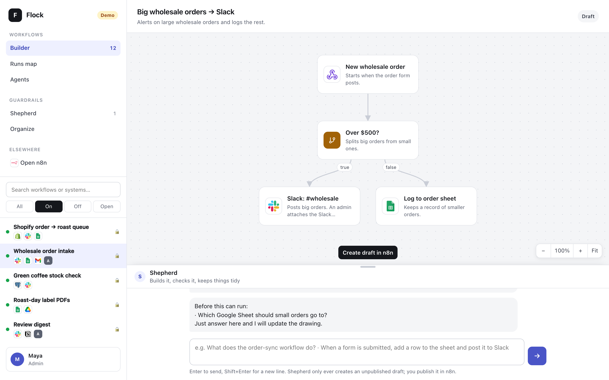
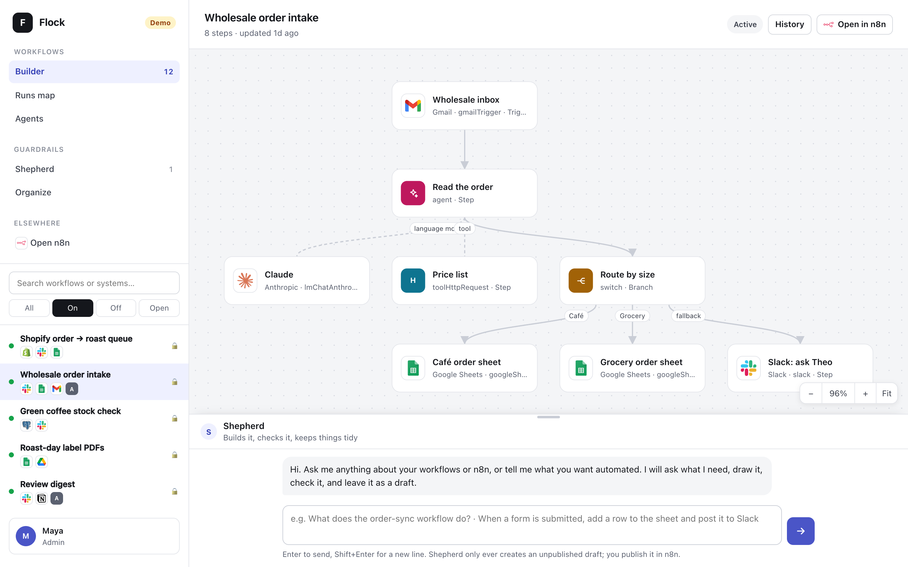
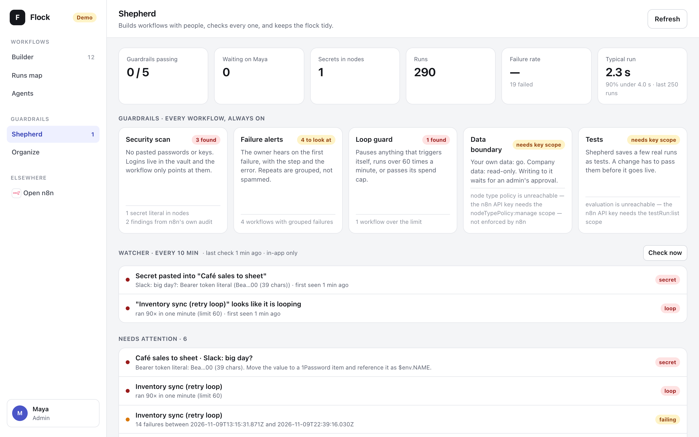
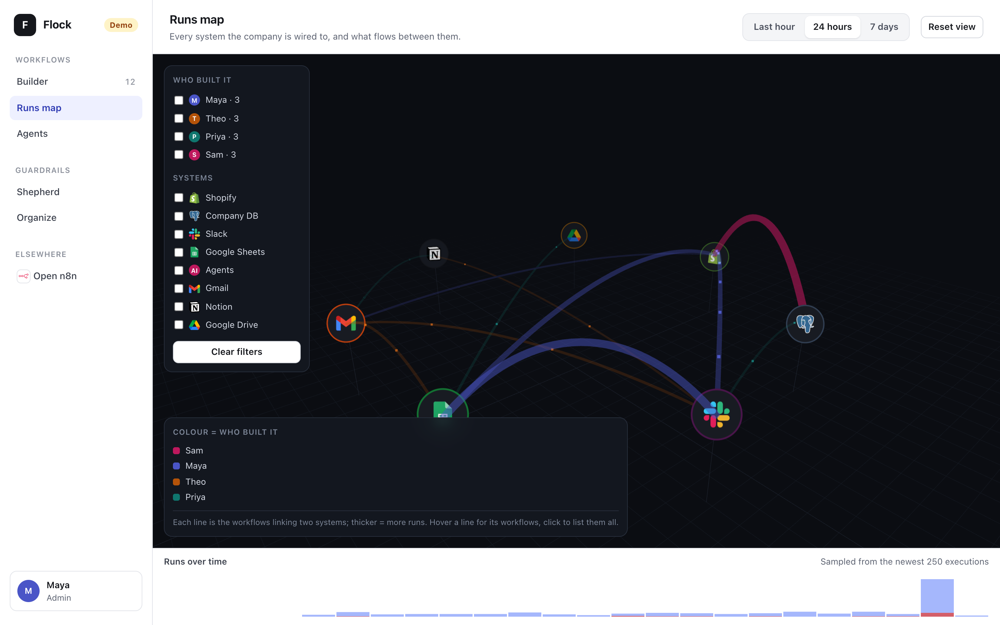
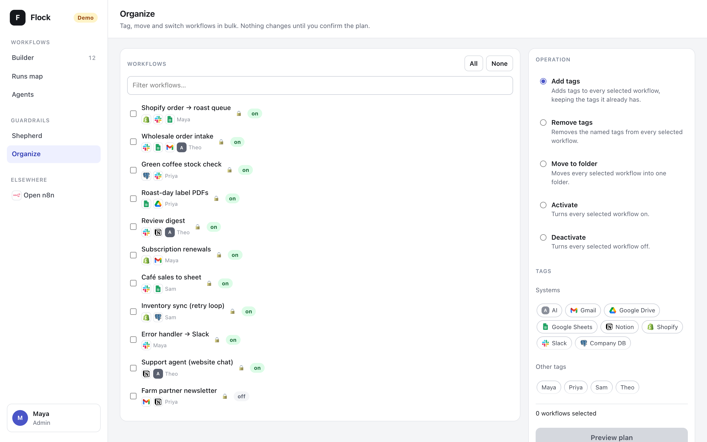
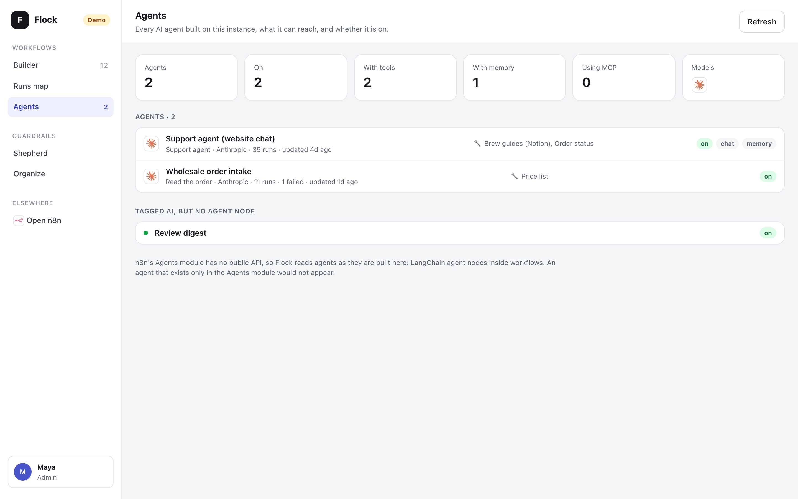

# Flock

**A dashboard and safety layer for self-hosted n8n.** Flock draws every workflow
with its real branches, lets your team ask an AI to draft new workflows
without letting it publish anything, catches pasted API keys and runaway loops,
and lets you tag, move and switch workflows in bulk. It adds team features that
the free n8n Community Edition doesn't include, and it runs beside your n8n
instead of replacing it.

[](https://github.com/fightmilk808/flock/actions/workflows/ci.yml)




<sub>Every screenshot is Flock's built-in demo: a made-up coffee roaster with 12 workflows. None of it is real data.</sub>

## Try it in 30 seconds

You need Node 22.13 or newer. Nothing else: Flock has no npm dependencies and
the demo needs no n8n and no keys.

```bash
git clone https://github.com/fightmilk808/flock.git
```

```bash
cd flock && npm run demo
```

Open <http://127.0.0.1:4174>. In the Shepherd box, type *"When a wholesale order
is over $500, post it to Slack"*, then answer its question.

## Who it's for

Small teams that run **n8n Community Edition on their own server**, where one
person owns the automations and other people want to see, request or tidy
them. Community Edition is a great engine, but n8n puts most team features
(sharing, roles, SSO, audit logs, the Insights dashboard, log streaming) in its
paid Business and Enterprise plans. Flock covers part of that gap from the
outside, through n8n's public REST API.

## What Flock adds to n8n Community Edition

| You want… | n8n Community Edition | With Flock |
| --- | --- | --- |
| **A picture of what runs where** | The editor, one workflow at a time. The Insights dashboard is Business or Enterprise; Community gets a 7-day summary banner. | A **runs map**: every system on a 3D ring, workflows as lines between them, thicker for more runs. Filter by person or system, and see a 24-hour or 7-day timeline with failures in red. |
| **Workflows people can read** | The editor canvas. | A top-to-bottom drawing with branches labelled the way n8n labels them (IF true/false, Switch outputs, loop/done, error outputs). It has brand logos, zoom, pan and fit, and AI sub-nodes hang under their agent. |
| **Help building workflows** | Recent versions add an AI assistant you can self-host with your own key (preview). | **Shepherd**, a chat that asks questions before it draws. Every draft is checked by fixed rules (no Code or shell nodes, no pasted keys, no localhost calls, no copies of existing workflows) and can only be created **unpublished**. Risky drafts wait for an admin's approval. |
| **Catching mistakes** | Error workflows you wire up yourself. No scan for pasted secrets. | **Guardrails** run every 10 minutes by default, even when nobody has Flock open: keys pasted into nodes, loops (over 60 runs a minute), grouped repeat failures, writes to company data, and test status. New problems can post to Slack. |
| **Roles: who may change what** | Sharing, projects and roles are Business or Enterprise. | An **infrastructure lock**: anything live, anything touching a company system, and anything with shell, SSH or file nodes can only be changed through Flock by an admin. Everyone else can organize the rest. |
| **Sign-in for the team** | SAML and LDAP are Business or Enterprise. | Put Flock behind **Cloudflare Access** and it checks the signed Access token on every request. Admins are a list of emails. |
| **Who did what** | Audit logging is Enterprise. | Every draft, approval, refusal and bulk change made **through Flock** goes to its own SQLite audit log. |
| **Bulk tidying** | One workflow at a time. | **Organize**: add or remove tags, move to a folder, switch on or off across a selection. You preview the plan first; nothing changes until you confirm. |
| **An inventory of your AI agents** | Open each workflow. | **Agents**: every LangChain agent node with its model, tools, memory and MCP use. |
| **Knowing what your licence allows** | Errors when you try. | Flock checks each feature once and says *unlicensed*, *missing key scope* (naming the scope) or *error*, instead of failing. |

> [!NOTE]
> Flock adds these features **for actions taken in Flock**. It doesn't change n8n's own permissions: anyone who can log in to the n8n editor can still do anything there. Flock is a separate app and is not made, endorsed or supported by n8n GmbH. Plan details are from [n8n's pricing](https://n8n.io/pricing) and [Community Edition docs](https://docs.n8n.io/deploy/host-n8n/community-edition-features) as of November 2026; check them for your version.

## Screens

### Builder

Pick a workflow on the left and see it drawn with its branches. Merges join
back up, loops are routed round the side, and steps that skip a row get their
own lane so lines never run behind cards. Shepherd sits underneath; drag its
edge to resize it.



### Shepherd and the guardrails

Each guardrail card shows its evidence. If Flock can't check something, the card
says why ("needs key scope") instead of passing it. Below the cards is everything
that needs attention, with the reason for each.



### Runs map



### Organize



### Agents



## Connect it to your n8n

1. In n8n, create an API key: **Settings → n8n API**. For the full set of
   guardrails, give it these scopes: workflow read and write, execution read,
   tag read and write, and (if your plan has them) `nodeTypePolicy:manage` and
   `testRun:list`.
2. Start Flock with two environment variables:

```bash
export FLOCK_N8N_URL=https://n8n.example.com
```

```bash
export FLOCK_N8N_API_KEY=your-n8n-api-key
```

```bash
npm start
```

Flock listens on `127.0.0.1:4174`. To turn on Shepherd, also set
`FLOCK_SHEPHERD_API_KEY`. It works with any OpenAI-compatible endpoint:
OpenRouter by default, or set `FLOCK_SHEPHERD_BASE_URL` and
`FLOCK_SHEPHERD_MODEL`. Without that key, Shepherd stays off and the rest of
Flock still works.

For a team setup (Docker, Cloudflare Access, Slack alerts, admins, your own
domains), see [docs/configuration.md](docs/configuration.md) and
[docker-compose.example.yml](docker-compose.example.yml).

## What Flock will never do

- **Publish, archive or delete.** The n8n client has a fixed list of writes it
  allows: create an unpublished draft, run n8n's read-only security audit,
  replace tags, move to a folder, and switch on or off. Every other request is
  refused before it is sent. Publishing stays a human click in n8n.
- **Read a credential's value.** It only ever sees credential names.
- **Keep a secret in a file.** Config values for keys must be `env:NAME` or
  `op://` (1Password CLI) references. A pasted key in the config stops Flock
  from starting.
- **Invent data.** A missing field shows as "unknown", never a plausible guess.
  (Demo mode is the exception: all of it is made up, and the sidebar says
  **Demo**.)

## Known limits

- **Attribution is inferred.** Community Edition has one project, so Flock
  works out who owns a workflow from a person tag on it (for example `Maya`),
  then falls back to the instance owner.
- **Roles and the audit log cover Flock only.** See the note above.
- **Version history shows what n8n keeps.** Flock lists versions n8n returns
  (about 24 hours on Community Edition); it doesn't store more.
- **The runs map samples the newest 250 executions.**

## Development

```bash
npm test
```

There are 239 tests over the pure logic: config validation, the write allowlist, the
secret scanner, the loop guard, graph layout, draft validation, approvals,
capability probes, guardrails, bulk planning and the demo instance. No test
touches the network. The browser code is plain ES modules in `web/`, with no
build step.

See [CONTRIBUTING.md](CONTRIBUTING.md) and [SECURITY.md](SECURITY.md). Coding agents: start with [AGENTS.md](AGENTS.md).
Licensed [MIT](LICENSE).
